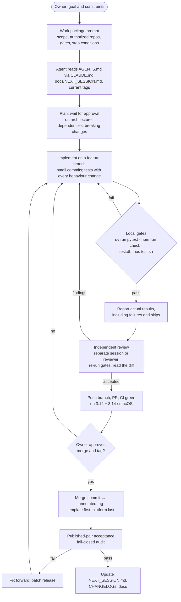

# The AI-assisted workflow

The platform was built, and is meant to be extended, with AI coding agents (Claude Code) doing most of the implementation, under rules written into every repository and verified by tests and gates that do not trust the agent's own report.

## The workflow

## Principles, as practised

| Principle | How it is enforced |
|---|---|
| Rules live in the repository, not in the prompt | `AGENTS.md` in every repo and every generated project; `CLAUDE.md` is one line, `@AGENTS.md` |
| The agent does not decide architecture | "Plan first … wait for approval on architectural decisions"; `devkit` itself refuses to pick a database provider |
| The agent does not publish | "Do not commit, push, tag, publish, deploy or rewrite history unless explicitly asked. Never move or delete a published tag." |
| The agent does not add dependencies | "Do not add, upgrade or remove dependencies without approval"; exact pins; two-week age rule enforced by `exclude-newer` and tests |
| Done means the gate passed | "Work is not done until `uv run pytest` / `npm run check` passes. Report actual results, including failures." |
| Destructive commands are impossible to slip in | a test in each repo fails if code, CI or documented snippets contain them |
| Trust nothing the agent says about itself | independent review and a fail-closed acceptance audit that parses exit codes and counts |
| Authorized repositories only | each work package names the repositories that may change; acceptance gates prove the others did not |

## Pages

- [AGENTS.md, CLAUDE.md and trust boundaries](instructions.md)
- [Sessions, prompts and review](sessions.md)
