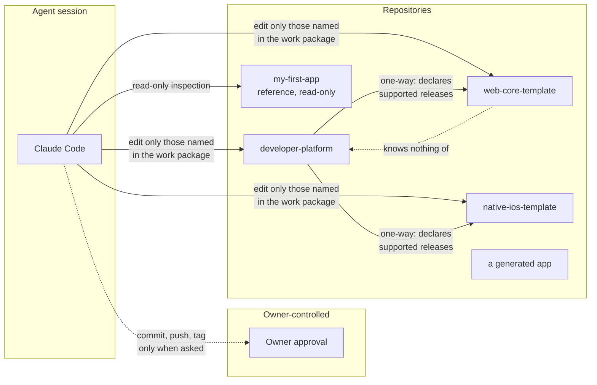

# AGENTS.md, CLAUDE.md and trust boundaries

## The files

| File | Where | Content |
|---|---|---|
| `AGENTS.md` | each of the three source repositories | that repository's commands, working agreement, boundaries, destructive-command rules, secure coding |
| `CLAUDE.md` | beside every `AGENTS.md` | exactly `@AGENTS.md` (Claude Code imports the file, so one set of rules serves every agent) |
| `AGENTS.md` (generated) | every generated project | rendered from `template/AGENTS.md.jinja`: the Next.js agent block, the working agreement, and feature-specific secure-coding rules |
| `ios/AGENTS.md` (generated) | native-ios projects | the native layer's rules; the web `AGENTS.md` points to it and forbids editing `ios/` from web work |
| `docs/NEXT_SESSION.md` | developer-platform | the handoff: where everything is, published vs proposed, test results, unresolved decisions, the release sequence, the next task |

## The working agreement (common to all)

- Plan first for anything beyond a trivial fix; wait for approval on architectural or breaking decisions.
- Small, focused changes; no drive-by refactors.
- No dependency changes without approval; exact pins; the two-week release-age rule.
- No commit, push, tag, publish, deploy or history rewrite unless explicitly asked; never move or delete a published tag.
- Never install software globally or change workstation configuration (`doctor` stays read-only).
- Never overwrite or delete user data; `devkit new` must keep refusing existing destinations.
- Work is not done until the gate passes (`uv run pytest`, or `npm run check` in projects); report actual results, including failures.
- Update `README.md`, `CHANGELOG.md` and `docs/` when behaviour changes.

## Repository trust boundaries

| Boundary | Rule | Enforcement |
|---|---|---|
| Platform ↔ templates | one-way: the platform declares support; templates must not know devkit; content rules only in `copier.yml` | contract tests, snapshots, live gate |
| Web ↔ native layer | neither writes the other's files; web tooling ignores `ios/`; agents read `ios/AGENTS.md` before touching it | template tests in both directions |
| Repository ↔ workstation | no global installs, no configuration changes; `doctor` read-only | `AGENTS.md`; doctor runs only queries |
| Repository ↔ credentials | `devkit` never prompts for, reads, stores or echoes credentials; Git runs with prompting off; URL credentials redacted; CI holds no secrets | code, CI tests, report scan |
| Agent ↔ authorized repositories | a work package names what may change; everything else is read-only (for example the reference app `my-first-app`) | the acceptance audit's "local repo HEAD, status, tags and branches unchanged" gates |
| Template answers ↔ generated code | every answer is untrusted: validated in `copier.yml`, rendered only through safe filters (`to_json`, restricted character sets) | template tests with awkward answers |

## Destructive commands

From every `AGENTS.md`:

- **Never** run recursive or forced removal by hand (`rm -r`, `rm -rf`), `find … -delete`, `git clean`, `git reset --hard`, forced pushes or recursive `chmod`/`chown`. A test fails if any appear in the repository's code, CI or documented shell snippets.
- **Prefer not deleting**: make a fresh, unique directory for every run (`tools/scratch.py new`, `mktemp -d`, pytest's `tmp_path`).
- When something must be removed, use `uv run python tools/scratch.py clean WORKSPACE [CHILD…]`, which deletes only paths provably inside a workspace it created and refuses symlinks, `..` escapes, `/`, the home directory and the current directory.
- Never hide a state-changing command's errors (`2>/dev/null`).
- Tests of destructive behaviour use the pure validator `assert_removable`; nothing that can delete is ever pointed at a system path.
- Anything that would remove user data, a repository, a tag or a branch needs explicit approval first.

### The destructive-command incident

These rules exist because of a real event, analysed in `developer-platform/docs/milestone-release-hardening.md`. During a milestone, an agent-issued command contained `rm -rf /dev/null 2>/dev/null`, written where a not-yet-assigned scratch-directory variable belonged. It ran as the user and was **not** blocked by the harness; its own exit status was hidden by the `2>/dev/null`. Read-only checks afterwards showed no filesystem object was affected (`/dev` is not writable by the user and `/dev/null` was intact). The lesson was explicit: harness permission checks cannot be the only safeguard, and hiding a state-changing command's errors is itself a defect. The response was structural: the lint test (with the exact incident command as a negative control), `tools/scratch.py`, the "Destructive commands" section in every `AGENTS.md`, and the habit of fresh unique directories instead of clearing old ones.

## Secure-coding rules agents must follow in generated projects

Selected from the generated `AGENTS.md` (they appear only with the relevant feature):

- Validate every external input on the server with the shared Zod schemas; `safeParse` at the boundary.
- API v1 is additive-only; responses validated against explicit schemas; errors via `problem()`.
- Database access is server-only, parameterized, through `withTransaction`/`withPrincipal`; schema changes only by new migrations + `db:lock`.
- Protected routes use `withAuthentication`; user data only through `withPrincipal` and an owner-scoped repository; `app_runtime` stays least-privilege; every user-data table gets `owner_id` and RLS; never 403 where 404 hides existence.
- Never disable origin/CSRF checks, trust a client-supplied address header, commit a secret, or put a token in a URL, log or response body.
- After changing a schema or route, `npm run openapi:generate` and commit; do not edit `ios/` from web work.
- iOS: never hand-write API types; the token lives only in the Keychain; Release is https-only with no ATS exception; no committed signing identity; every behaviour change needs a test, and no test is weakened to pass.
