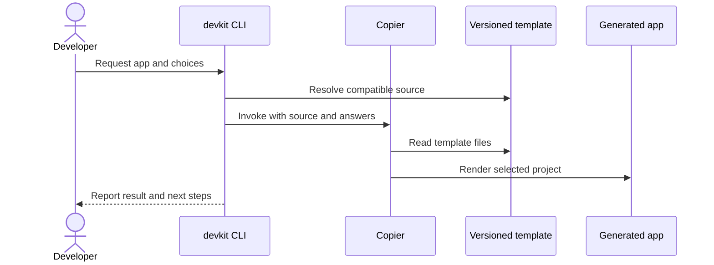

# devkit CLI and Copier

**Verified against the tagged v0.2.0 platform CLI and v0.1.0 template.** The console script is `devkit = devkit.cli:main`; available commands are `doctor` and `new`. There is no released `devkit upgrade` command.

`devkit new NAME` validates the destination as one safe path segment, checks that the output folder exists and destination does not, parses only profile-declared `--set` options, resolves a compatible published tag or an explicitly selected local/URL source, then invokes Copier. It does not install dependencies or initialize a GitHub repository. Copier handles app content validation and records provenance. `--dry-run` prints the intended operation without writing. `devkit doctor` only reads versions/configuration and reports prerequisite status.

Use [Create your first Web Core application](../getting-started/first-application.md) for released command syntax. Failures involving a private template need Git credentials configured outside `devkit`; the platform runs Git with prompting disabled, redacts credentials from errors, and never handles credentials itself. The `--template PATH` development mode renders the working tree as-is; unlike published mode, it records a home-relative path and is not portable.
