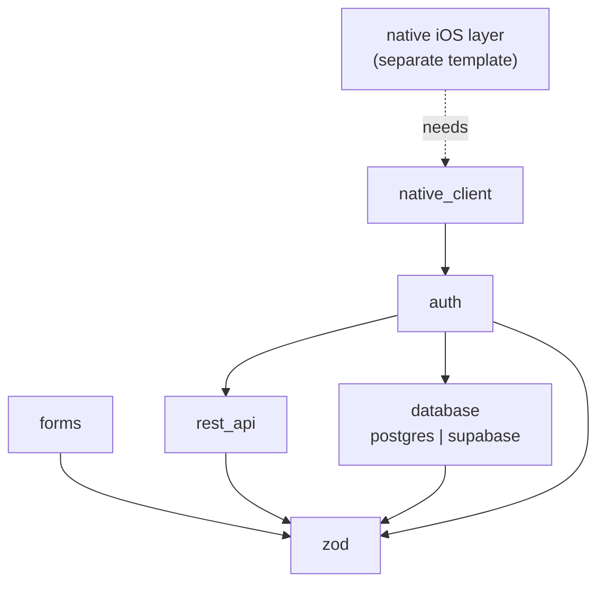

# Feature composition and layering

Two composition mechanisms exist, and they solve different problems:

| Mechanism | Used for | Why |
|---|---|---|
| **Optional features inside one template** (Copier questions + conditional files) | `zod`, `forms`, `rest_api`, `database`, `auth`, `native_client` | Additive modules sharing one toolchain (npm) and one release cadence |
| **A second template layer in the same directory** (own answers file) | the native iOS app | A different toolchain (Xcode, SwiftPM), owner and release cadence |

## Features



| Feature | Since | Requires | npm deps | Adds |
|---|---|---|---|---|
| `zod` | 0.2.0 | – | `zod` | `src/lib/schemas/` |
| `forms` | 0.3.0 | zod | `react-hook-form`, `@hookform/resolvers`; dev: Testing Library, jsdom | example form |
| `rest_api` | 0.4.0 | zod | none | `/api/v1`, RFC 9457 problems |
| `database` | 0.5.0 | zod | `pg`, `server-only`, `@types/pg`; `supabase` (dev) for that provider | migrations, data layer, `db:*` |
| `auth` | 0.6.0 | zod, rest_api, database | `better-auth` | Better Auth, `app_runtime`, RLS, protected API |
| `native_client` | 0.7.0 | auth | none | bearer plugin, OpenAPI 3.1 contract |

### Rules are the template's

`requires` rules are written in `features.yml` (read by tools and tests) and enforced by **validators in `copier.yml`** (the only thing every front-end hits). A parity test fails if they drift. `devkit` deliberately does **not** duplicate them: it knows each option's type, default, `since` and stickiness, and reports the template's rejection as exit 2. Prerequisites are **never auto-enabled**: failing with "forms requires zod" keeps the selection explicit and recorded.

### Strict booleans

Copier casts a `type: bool` answer before validators run, so `--data zod=banana` once silently enabled Zod. Every boolean is therefore written as:

```yaml
zod:
  type: yaml
  default: false
  choices: [false, true]
  validator: "Answer true or false."
```

Accepted: `true/false`, `yes/no`, `on/off` (lower, Title, UPPER). Rejected: `banana`, `1`, `0`, `y`, empty, null. Answers are still recorded as real booleans, so older projects upgrade cleanly. `devkit --set` additionally parses booleans strictly before any network access.

### Choice features

`database` is one validated choice (`none`, `postgres`, `supabase`) rather than mutually exclusive flags, so two providers cannot be selected.

### Sticky options

Some selections cannot be undone by an upgrade, because undoing them is a data decision:

| Option | Once set to | `devkit upgrade --set` refuses | Reason |
|---|---|---|---|
| `database` | `postgres` or `supabase` | any other value, including `none` | swaps tooling under existing data; moving data is not automated |
| `auth` | `true` | `false` | would orphan accounts, sessions and data ownership |
| `native_client` | `true` | `false` | a native app may depend on it; removal is a manual code change |

Repeating the established value is fine. Raw `copier update --data …` has **no** such protection.

### Switching features on later

`devkit upgrade PROJECT --set FEATURE=true` (with the prerequisites already present) adds the files, dependencies and the matching lockfile through Copier's merge. Switching a feature **off** is not automated: remove its files and dependency by hand, or regenerate.

## Layers

| | Web layer | Native layer |
|---|---|---|
| Template | `web-core-template` | `native-ios-template` |
| Owns | everything except `ios/` | `ios/` only |
| Answers file | `.copier-answers.yml` | `.copier-answers.ios.yml` |
| Releases (baseline) | `v0.7.x` | `v0.1.x` |
| Upgrade | `devkit upgrade P --layer web` | `devkit upgrade P --layer native` |
| Gate | `npm run check` | `sh ios/scripts/test.sh` |

The coupling between layers is **one artifact**: the OpenAPI contract. The native release records which web release's contract it was generated from, and `devkit` encodes the compatible pairs in `NATIVE_REQUIRES_WEB`. Layering was a hypothesis until this release; it was prototyped and adopted in devkit 0.8.0. It does not solve npm lockfiles (an app has one lock), so any future layer adding npm dependencies would still join the lock matrix.
