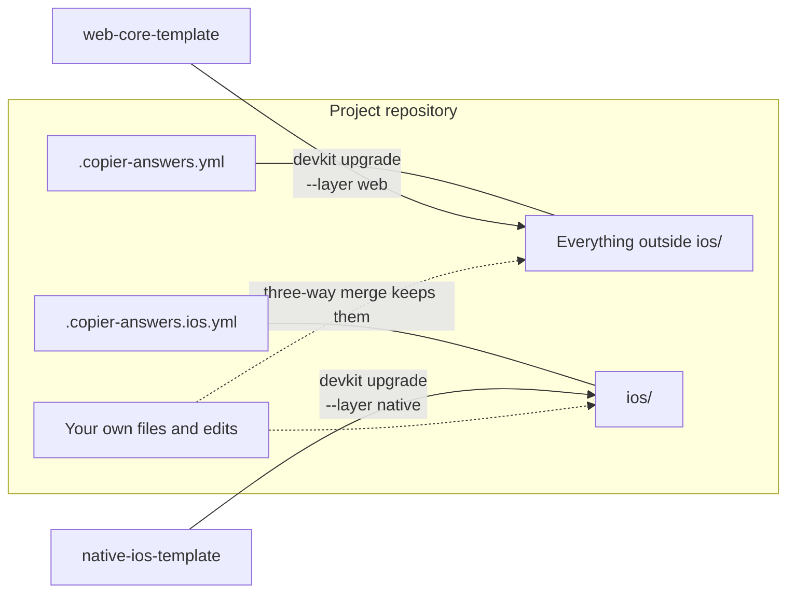

# Generated application repositories

A generated project is an ordinary, independent Git repository. The platform has no runtime presence in it: no dependency on `devkit`, no hidden files beyond the answers files, nothing that phones home. The templates only re-enter its life when you deliberately upgrade.

## What each profile produces

| Path | web-core | full-stack | native-ios |
|---|:-:|:-:|:-:|
| `src/app`, `src/components/ui`, `src/lib`, Next/TS/ESLint/Prettier/Vitest config, CI, `AGENTS.md`, `CLAUDE.md` | ✓ | ✓ | ✓ |
| `src/lib/schemas/` (Zod) | `zod` | ✓ | ✓ |
| `src/app/forms-example/`, `src/components/forms/` | `forms` | `forms` | `forms` |
| `src/app/api/v1/`, `src/server/api/`, `src/lib/schemas/v1/`, `docs/api-v1.md` | `rest_api` | ✓ | ✓ |
| `compose.yaml` (postgres) or `supabase/config.toml` (supabase), `supabase/migrations*`, `scripts/db/`, `src/server/db/`, `src/server/items/`, `.env.example`, `vitest.db.config.mts`, `docs/database.md` | `database` | ✓ | ✓ |
| `src/server/auth/`, `src/app/api/auth/`, `src/lib/auth-client.ts`, items/session routes, auth migrations, `.npmrc`, `docs/auth.md` | `auth` | ✓ | ✓ |
| `openapi/openapi.json`, `src/lib/openapi/`, `scripts/openapi.mjs`, `docs/native-client.md`, bearer plugin | `native_client` | – | ✓ |
| `ios/`, `.copier-answers.ios.yml` | – | – | ✓ |

## Ownership inside the project



- Files the template created are **shared** between you and the template: you may edit them; an upgrade merges the template's changes with yours.
- Files you add are **yours**; upgrades never touch them (tests prove a user file beside a template file survives).
- The answers files are **the template's**: commit them, never edit them (exception: `_src_path` if the template repository moves).

## Provenance

```yaml title=".copier-answers.yml (native-ios profile)"
_commit: v0.7.0
_src_path: https://github.com/audiophreak/web-core-template.git
app_description: A Next.js application
app_name: nat-app
auth: true
cache_components: true
database: postgres
forms: false
native_client: true
rest_api: true
zod: true
```

```yaml title=".copier-answers.ios.yml"
_commit: v0.1.0
_src_path: https://github.com/audiophreak/native-ios-template.git
app_display_name: Nat App
app_name: nat-app
bundle_identifier: com.example.natapp
debug_api_port: 3000
release_api_host: api.example.com
```

`devkit upgrade` refuses a project whose `_commit` is not a plain release tag: `v0.6.1-3-gabc1234` (generated from commits after a release) cannot be matched to a release, and a project generated in local mode records `~/…` as `_src_path` (upgradable only from that checkout, with a warning).

## Rules generated projects carry

Every project's `AGENTS.md` states the same working agreement (plan first, small changes, no dependency changes without approval, no commits or pushes unless asked, work on a branch, `npm run check` must pass) plus feature-specific secure-coding rules (validate with shared Zod schemas, server-only data access, `withAuthentication` + `withPrincipal`, `app_runtime` least privilege, never put the token in a URL or log, regenerate the contract after API changes). `ios/AGENTS.md` adds the native rules. See [AGENTS.md, CLAUDE.md and trust boundaries](../ai-workflow/instructions.md).
