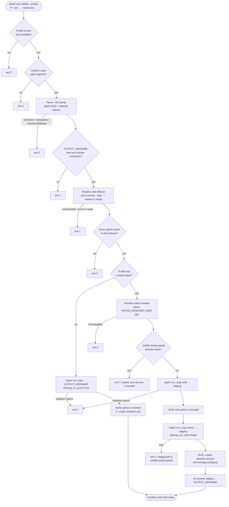

# Generation flow and atomicity

## `devkit new`, step by step

Validation order matters: everything that can be checked without the network or the filesystem is checked first, so a typo never touches GitHub or creates a directory.

## Single-layer generation

For `web-core` and `full-stack`, Copier renders straight into the destination with `cleanup_on_error=True`: if rendering fails, Copier removes the directory **it** created (the destination did not exist before, by rule). If anything remains, the message says `Partial output may remain at …; inspect it before deleting`.

## Two-layer generation: staging and atomic move

For `native-ios`, a failure after the web layer but before the native layer would otherwise leave a project that *looks* complete but has no `ios/`. So:

1. The staging directory is `OUTPUT_DIR/.NAME.devkit-partial` (hidden, beside the destination, same filesystem, so the final `rename` is atomic).
2. Both layers render into it. The native layer runs with `cleanup_on_error=False` because the web layer is already there.
3. Only after both succeed and are verified is it renamed to `OUTPUT_DIR/NAME`. If something appeared at `NAME` meanwhile, it stops and tells you where the finished project is.
4. On failure **nothing exists at `NAME`**, and the partial result is left at `.NAME.devkit-partial` for inspection. `devkit` never deletes it and refuses to run again for that name until you have dealt with it.

`--dry-run` uses Copier's `pretend` for both layers and creates no staging directory.

Recovery: [A failed two-layer generation](../upgrade/recovery.md#a-failed-two-layer-generation-devkit-partial).

## What Copier does during a copy

1. Clones the template at the exact ref (`vcs_ref`).
2. Asks questions in `copier.yml` order, taking answers from `data` and defaults (`defaults=True`); computed `when: false` questions are evaluated but not recorded.
3. Runs validators; a non-empty validator result aborts before writing (`Validation error for question …` → exit 2).
4. Renders `template/`: `.jinja` files are templated and lose the suffix; paths that render empty are skipped; `locks/<lock_key>.json` is included into `package-lock.json`.
5. Writes the answers file (`_src_path`, `_commit`, answers).

No task, migration or extension runs. No `npm install`, no network beyond the template clone.

## `devkit native add`

The same native step applied to an existing, clean, committed full-stack project with `native_client: true`, directly in place (no staging, `cleanup_on_error=False`). It adds only `ios/` and `.copier-answers.ios.yml`; you review `git status` and commit.
