# Platform Architecture

## Three repositories, three version lines, one-way dependency

```mermaid
flowchart TB
  subgraph DP ["developer-platform  (v0.8.0)"]
    cli[devkit CLI<br/>doctor · new · status · upgrade · native add]
    reg[Profile registry<br/>profiles.py]
    snaps[Contract snapshots<br/>tests/contracts/]
    brew[Brewfile]
  end
  subgraph WT ["web-core-template  (v0.7.0)"]
    wq[copier.yml<br/>questions + validators]
    wf[template/<br/>Next.js app files]
    wl[locks/<br/>11 lockfiles]
    wfe[features.yml]
  end
  subgraph NT ["native-ios-template  (v0.1.1)"]
    nq[copier.yml]
    nf["template/ios/<br/>SwiftUI app + generated client"]
    nc[tools/web_contract.json<br/>web v0.7.0 contract sha256]
  end
  subgraph APP [Generated application repository]
    a1[.copier-answers.yml<br/>web provenance]
    a2[.copier-answers.ios.yml<br/>native provenance]
    web[Next.js app, API, DB, auth<br/>openapi/openapi.json]
    ios["ios/  (native-ios profile)"]
  end
  reg -->|declares supported ranges<br/>and options| WT
  reg -->|NATIVE_REQUIRES_WEB| NT
  snaps -. offline copy of each release's questions .-> wq
  cli -->|copier run_copy / run_update<br/>at a release tag| WT
  cli -->|second layer| NT
  WT --> web & a1
  NT --> ios & a2
  nc -. generated against .-> web
```

| Repository | Owns | Must not |
|---|---|---|
| `developer-platform` | the CLI, workstation checks, **which releases and options are supported** (`profiles.py`), profile composition, source resolution, safety (staging, clean-tree checks, sticky options), contract snapshots | contain application content or mirror the templates' rules |
| `web-core-template` | **what a web application contains**: every question, default and validator, the files, the lockfile matrix, its own tests and upgrade docs | know that `devkit` exists |
| `native-ios-template` | `ios/` and `.copier-answers.ios.yml` only; the contract of the web release it was generated against | write or rewrite any web file |
| generated application | everything after generation: your code, your history | edit `.copier-answers*.yml` by hand |

**Why separate repositories?** Copier upgrades a project by re-rendering the template at the recorded release and at the target release, so a template must be one Git repository whose tags are its releases. Keeping `devkit` in the same repository would tie every CLI change to a template release. The cost (a contract across repositories that could drift) is controlled by making the dependency one-way, putting every content rule in the template, and testing the contract offline (snapshots) and live (release gate). See [Compatibility and contract snapshots](compatibility.md).

## In this section

| Page | Topic |
|---|---|
| [developer-platform (devkit)](developer-platform.md) | modules, the registry, source resolution, exit codes, safety rules |
| [The two templates](templates.md) | Copier layout, validators, lock matrix, the native add-on |
| [Generated application repositories](generated-projects.md) | what is generated, answers files, ownership |
| [Generation flow and atomicity](generation-flow.md) | `devkit new` step by step, staging, `.devkit-partial` |
| [Feature composition and layering](feature-composition.md) | features, strict booleans, requires rules, sticky options, layers |
| [Compatibility and contract snapshots](compatibility.md) | ranges, `since`, pair rules, snapshots, provenance |
