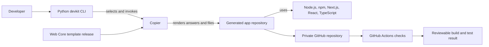

# Developer Platform architecture overview

**Verified against release tags `developer-platform v0.2.0` and `web-core-template v0.1.0`.** The platform repo is Python CLI/workstation tooling; the template repo owns its Copier config, application source, validation tests, and template upgrade guidance. The repositories have independent version lines.

`devkit new` resolves the Web Core profile's template release range, then invokes Copier to render a new application. At v0.2.0 the profile supports template `>=0.1.0,<0.2.0`, Node 26, and the `cache_components` boolean option. The generated project records template origin and commit in `.copier-answers.yml`. The template provides the web application and npm lockfile; the platform does not own app code.

## Trust and lifecycle boundaries

Generation is an explicit provisioning event. The generated repo has its own history and can diverge. Template updates require an explicit migration process; they should not be assumed to flow into an existing project automatically. Generated code also crosses a trust boundary when it runs scripts or installs dependencies, so inspect the template and lockfiles before execution.

## Verification needed

The CLI sets non-interactive Git prompt behavior and does not read or store Git credentials. Git uses the machine's credential helper to access the private template. `devkit doctor` is read-only; `devkit new` refuses to overwrite existing output and returns distinct codes for success, operational failure, or rejected input.

Related: [devkit and Copier](devkit-copier.md), [template versioning](template-versioning.md), [security boundaries](security.md), and [upgrade lifecycle](upgrade-lifecycle.md).
