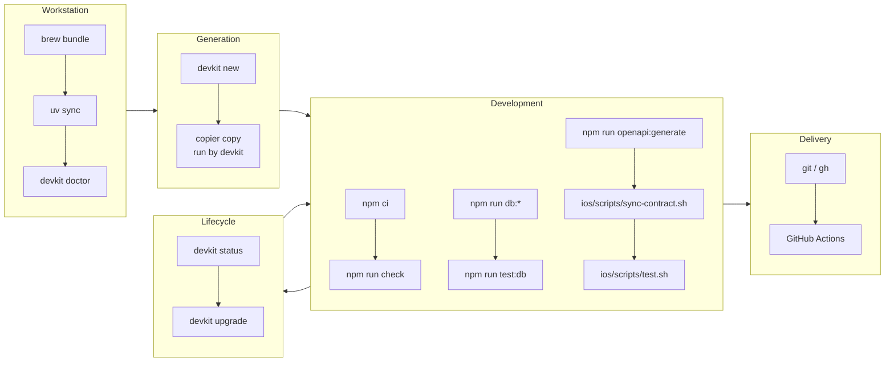

# Command Reference

Commands are grouped by the tool that owns them. Each page gives the purpose, normal usage, the options that matter, where the command sits in the workflow, and how it fails.

## By task

| I want to… | Command | Page |
|---|---|---|
| Check my workstation | `uv run devkit doctor` | [devkit](devkit.md#devkit-doctor) |
| Create a project | `uv run devkit new NAME [--profile …] [--set …]` | [devkit](devkit.md#devkit-new) |
| See a project's template layers | `uv run devkit status PROJECT` | [devkit](devkit.md#devkit-status) |
| Upgrade a project | `uv run devkit upgrade PROJECT [--layer web\|native] [--dry-run]` | [devkit](devkit.md#devkit-upgrade) |
| Add iOS to a full-stack project | `uv run devkit native add PROJECT` | [devkit](devkit.md#devkit-native-add) |
| Render a template by hand | `copier copy --vcs-ref vX.Y.Z …` | [Copier](copier.md) |
| Run platform or template tests | `uv run pytest [-m …]` | [uv, Python and pytest](python-uv.md) |
| Install a project's dependencies | `npm ci` | [npm](npm.md) |
| Run the web gate | `npm run check` | [npm](npm.md#npm-run-check) |
| Start, migrate, test the database | `npm run db:init / db:up / db:migrate / test:db` | [Database](database.md) |
| Create a user or debug sessions | `curl … /api/auth/sign-up/email`, `npm run db:roles` | [Better Auth operations](auth.md) |
| Regenerate the API contract | `npm run openapi:generate` | [OpenAPI and Swift](openapi-swift.md) |
| Regenerate the Swift client | `sh ios/scripts/sync-contract.sh` | [OpenAPI and Swift](openapi-swift.md) |
| Run iOS tests | `sh ios/scripts/test.sh [app\|package\|direct]` | [xcodebuild and simctl](xcode.md) |
| Run the real end-to-end scenario | `node ios/scripts/e2e.mjs` | [xcodebuild and simctl](xcode.md#the-end-to-end-scenario) |
| Branch, PR, check CI | `git switch -c`, `gh pr create`, `gh run watch` | [Git and GitHub](git-github.md) |

## By workflow stage

## Exit-code conventions

`devkit` uses the same codes for every subcommand:

| Code | Meaning | Example |
|---|---|---|
| `0` | success, already up to date, or a completed dry run | `devkit upgrade --dry-run` |
| `1` | a valid request could not be completed safely | destination exists; dirty tree; template unreachable; generation failed |
| `2` | rejected input or an unsupported transition | unknown option; `forms` without `zod`; release outside the range; sticky option changed; `--layer` missing in a two-layer project |
| `3` | upgrade finished with merge conflicts left inline | resolve `<<<<<<<` markers, `git add`, commit |

Raw `copier update` exits `0` even when it leaves conflict markers. That is one reason to use `devkit upgrade`.
