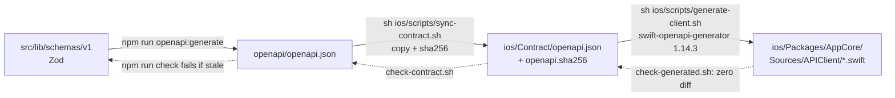

# OpenAPI and Swift packages

The API contract flows one way: **Zod schemas → `openapi/openapi.json` → `ios/Contract/openapi.json` → generated Swift client.** Every arrow is a command, and every arrow has a drift check. See [Generated API client](../ios/api-client.md) for the design.



## npm run openapi:generate

**Purpose.** Rewrite `openapi/openapi.json` (OpenAPI 3.1) from the Zod schemas and the operation list in `src/lib/openapi/document.ts`. It runs `src/lib/openapi/document.test.ts` twice: once with `OPENAPI_WRITE=1` to write, once with writing off to verify.

**When.** After changing any schema in `src/lib/schemas/v1/` or any route under `/api/v1`. Commit the result with the change.

**Failure modes.** `npm run check` fails when the committed file differs from what the schemas generate, a route has no operation (or vice versa), a protected route lacks `bearerAuth`, a documented status disagrees with a handler, or documented list bounds differ from the Zod schema. Generation is deterministic: regenerating an unchanged project produces a byte-identical file (an acceptance gate).

## iOS contract scripts (run from `ios/`)

| Script | Purpose | Fails when |
|---|---|---|
| `sh scripts/sync-contract.sh` | Copy `../openapi/openapi.json` into `Contract/`, write its SHA-256 to `Contract/openapi.sha256`, regenerate the client | the web part has no contract (`native_client` off) |
| `sh scripts/check-contract.sh` | Checksum matches, and `Contract/openapi.json` equals `../openapi/openapi.json` | either differs: run `sync-contract.sh` |
| `sh scripts/generate-client.sh [DIR]` | Run the pinned generator into `Packages/AppCore/Sources/APIClient` (or `DIR`) | Swift toolchain or package resolution problems |
| `sh scripts/check-generated.sh` | Generate into a fresh temp directory and `diff -r` against the committed client | the committed client is not what the contract generates |

After a sync: fix what the compiler and `sh scripts/test.sh` report, then **commit `Contract/` and the generated client together.** Never edit either by hand.

## Swift OpenAPI Generator

Configured by `ios/Contract/openapi-generator-config.yaml`:

```yaml
generate:
  - types
  - client
accessModifier: public
namingStrategy: idiomatic
```

It lives in its own package, `ios/Tools/Generator` (pinned `swift-openapi-generator` **1.14.3**), so the app never builds it and no build-tool plugin runs during a normal build. `generate-client.sh` invokes it as:

```bash
swift run --package-path Tools/Generator swift-openapi-generator generate \
  --config Contract/openapi-generator-config.yaml \
  --output-directory Packages/AppCore/Sources/APIClient \
  Contract/openapi.json
```

## Swift Package Manager

`ios/Packages/AppCore` is a local package with two library targets: `APIClient` (generated) and `AppCore` (configuration, auth, Keychain, middleware, models). Every dependency is `exact:` and `Package.resolved` is committed in three places (`Packages/AppCore`, `Tools/Generator`, and the Xcode project's workspace).

```bash
cd ios/Packages/AppCore
swift build
swift test                     # 58 tests on the Mac host (the Keychain store is tested in the hosted app instead)
swift package resolve          # only when deliberately changing a pin; commit Package.resolved
swift package show-dependencies
```

| Package | Pin | Why |
|---|---|---|
| swift-openapi-runtime | 1.13.4 | runtime for the generated client |
| swift-openapi-urlsession | 1.4.0 | URLSession transport |
| swift-http-types | 1.8.0 | HTTP types used by the bearer middleware |
| swift-collections | 1.7.5 | transitive; pinned older than newest to respect the two-week rule |
| swift-openapi-generator | 1.14.3 | generator tool only |

`xcodebuild` is always run with `-onlyUsePackageVersionsFromResolvedFile`, so a build can never silently resolve a different version.

**Raising a version** (`native-ios-template/docs/dependencies.md`): choose the newest stable release at least 14 days old, change the `exact:` pin, `swift package resolve`, commit `Package.resolved`, update the dependency table, regenerate the client if the generator moved, and check what the new version pulled in against the same rule.
