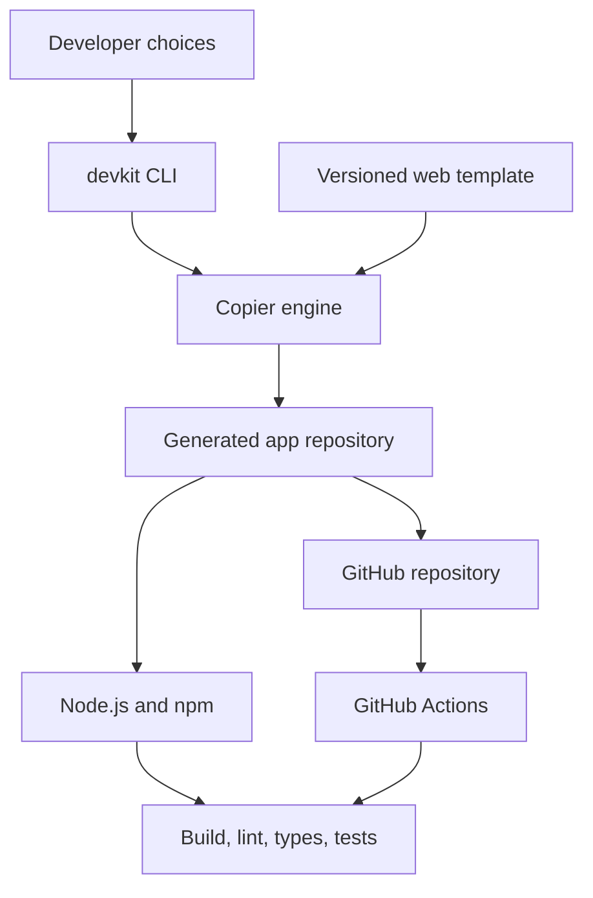

# How the components fit together

The platform toolchain and application toolchain intersect at project generation. Python/uv are associated with authoring and running platform-side tooling. Copier consumes a template and answer set to produce a new repository. The generated web project uses Node/npm and the Next.js/React/TypeScript stack. Git tracks both source projects and generated application changes; GitHub Actions can run project-defined automation.

This illustrates intended responsibilities from project context; it is not a source-verified call graph. Read the [architecture overview](../architecture/overview.md) for verification limits and [devkit and Copier](../architecture/devkit-copier.md) for the provisioning model.
