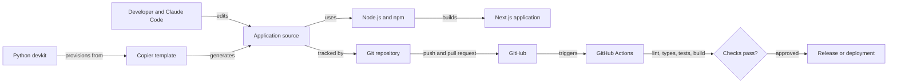

# The application development ecosystem

Modern application development is a chain of cooperating tools. Each tool owns a different concern; none replaces the others. Source code is authored in a language, executed by a runtime, composed with dependencies, transformed by a build system, checked by local and hosted automation, and delivered as an artifact or service.

## The main layers

| Layer | Role | Example in this project context |
|---|---|---|
| Provisioning | Creates a consistent project starting point | Python `devkit` and Copier (project details pending verification) |
| Application runtime | Executes application or tooling code | Node.js for Next.js; Python for platform tooling |
| Language | Expresses program behavior and types | TypeScript, Python |
| Framework | Supplies conventions and integrated capabilities | React, Next.js |
| Dependencies | Reusable packages resolved into a project | npm packages and Python packages |
| Validation | Detects defects and enforces quality gates | lint, type checks, tests, build |
| Source control | Stores reviewed change history | Git and GitHub |
| Automation | Repeats checks on proposed changes | GitHub Actions |
| Delivery | Makes an approved application available | deployment target depends on the app |

## How to reason about boundaries

Think of this like a network service chain. A packet traverses distinct layers with explicit interfaces; similarly, application code crosses package, runtime, framework, CI, and deployment boundaries. When a failure appears, locate the layer first: a Python command failure is different from an npm resolution error, and both differ from a GitHub Actions permission failure.

The diagram is a conceptual workflow, not a verified inventory of current repository files. The exact platform and template implementation is pending source inspection. For component relationships, see [how the components fit](component-map.md), and for runtime and package-manager boundaries, see [Python/uv versus Node/npm](runtimes-packages.md).
