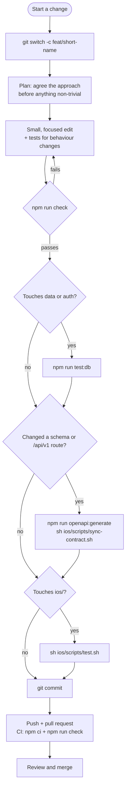

# Daily development workflow

The generated `AGENTS.md` is the working agreement for every project, for people and AI agents alike. This page turns it into a routine.



## The loop

```bash
git switch -c feat/item-notes
npm run dev                 # while you work
npm run check               # before every commit: lint, typecheck, format, tests, build
npm run format              # if format:check failed
git add -A && git commit -m "feat: add notes to items"
git push -u origin feat/item-notes
gh pr create --fill
```

Rules from the generated `AGENTS.md` that matter daily:

- Work on a branch, never directly on `main`.
- Do not add, upgrade or remove dependencies without approval; pin exact versions.
- Work is not done until `npm run check` exits 0. Report actual results, including failures.
- Add or update tests alongside behaviour changes.

## When you change…

| You changed | Also run | Why |
|---|---|---|
| Anything | `npm run check` | The gate. CI runs exactly this. |
| A migration, repository or auth code | `npm run db:up && npm run db:migrate && npm run test:db` | Database tests are excluded from `check`. CI's `database` job runs them on PostgreSQL. |
| The schema | add a **new** `supabase/migrations/<14-digit>_<name>.sql`, then `npm run db:lock` | Committed migrations are immutable; the lock detects edits. |
| A Zod schema in `src/lib/schemas/v1/` or a route under `/api/v1` | `npm run openapi:generate`, commit `openapi/openapi.json` | `npm run check` fails on a stale contract. |
| The API, in a native project | `sh ios/scripts/sync-contract.sh` then `sh ios/scripts/test.sh` | Copies the contract into `ios/Contract/` and regenerates the Swift client. |
| Anything under `ios/` | `sh ios/scripts/test.sh` (and `check-static.sh`) | The native gate. |
| Before a release of your app | `node ios/scripts/e2e.mjs` | The real scenario; not in CI. |

## Keep the tree clean

Template upgrades refuse a working tree with modified **or untracked** files. Commit or stash before `devkit upgrade`. Generated build output (`.next/`, `node_modules/`, `ios/.derived-data/`, SwiftPM `.build/`) is ignored by the generated `.gitignore` files.

## Starting and stopping services

```bash
npm run db:up        # start
npm run db:status    # what is running, migrations, runtime role
npm run db:down      # stop; data kept
```
