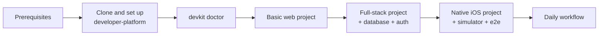

# Getting Started

This tutorial takes you from an empty macOS workstation to three working applications:

1. a **basic web project** (`web-core` profile): Next.js, TypeScript, Tailwind, shadcn/ui, tests and CI;
2. a **full-stack project** (`full-stack` profile): the web project plus Zod, a REST API, PostgreSQL and Better Auth;
3. a **native iOS project** (`native-ios` profile): the full-stack project plus a SwiftUI app with a generated API client.

| Step | Page | Time |
|---|---|---|
| 1 | [Prerequisites](prerequisites.md): Homebrew, Python/uv, Node, Docker, Xcode, Git/GitHub, Claude Code | 30–90 min (Xcode dominates) |
| 2 | [Repositories and setup](setup.md): clone, `uv sync`, `devkit doctor`, private-repository access | 10 min |
| 3 | [Your first web project](first-web-project.md) | 10 min |
| 4 | [A full-stack project](full-stack-project.md) | 20 min |
| 5 | [A native iOS project](native-ios-project.md) | 30 min |
| 6 | [Daily development workflow](daily-workflow.md) | reference |

## What you will have learned

- `devkit` never installs software, never overwrites a directory and never commits for you.
- A generated project records its template origin and release in `.copier-answers.yml` (and `.copier-answers.ios.yml` for the native layer); that record is what makes upgrades possible.
- `npm run check` is the gate for every web change; `sh ios/scripts/test.sh` is the gate for native changes; `npm run test:db` and `node ios/scripts/e2e.mjs` need local services and are run deliberately.
- Architectural choices (the database provider) are always yours: `devkit` refuses to guess.
