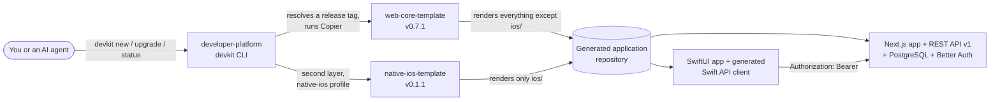

# Developer Platform Manual

The owner, operator and developer manual for the **accepted Developer Platform baseline**: what each part does, why it exists, how the parts work together, and how to generate, build, test, upgrade, troubleshoot and recover applications with it.

!!! success "Accepted baseline: 192 / 192 published acceptance gates passed"

    | Repository | Release | Commit |
    |---|---|---|
    | `audiophreak/developer-platform` | `v0.8.1` | `fc464344099bb96b1a58a590c4460e4ead9b1b51` |
    | `audiophreak/web-core-template` | `v0.7.1` | `f704572c35147597a24c2b1eb9b99dae332ea05b` |
    | `audiophreak/native-ios-template` | `v0.1.1` | `f0f4a5a8ac58825e94a38068df1bdd413d2f1596` |

    devkit v0.8.1 and web v0.7.1 are documentation-only releases over the original baseline (devkit v0.8.0, web v0.7.0, native v0.1.0, 151 / 151 gates), followed by the native v0.1.1 corrective patch (177 / 177); see the [release history](releases/history.md) and the archived [acceptance evidence](reference/acceptance-evidence.md). Every statement in this manual was checked against these tags. See [Accepted baseline](releases/index.md) and the [source verification map](reference/source-map.md).

## The platform in one picture

Three private repositories with independent version lines produce one application repository. `devkit` decides **which** template releases may be used; the templates decide **what** an application contains; the application owns everything after generation.

## Where to start

- **New to the platform?** Follow [Getting Started](getting-started/index.md) from prerequisites to a running native app.
- **Need a command?** Use the [Command Reference](commands/index.md), organized by task.
- **Want to understand the design?** Read [Platform Architecture](architecture/index.md), then [Web Application](web/index.md) and [Native iOS](ios/index.md).
- **Something broke?** Go to [Troubleshooting](troubleshooting/index.md) or [Recovery procedures](upgrade/recovery.md).
- **Working with Claude Code?** Read [AI-Assisted Development](ai-workflow/index.md).
- **Upgrading a project?** Read [Upgrade and Recovery](upgrade/index.md) first.

## The manual's sections

| Section | Answers |
|---|---|
| [Getting Started](getting-started/index.md) | How do I set up a workstation and produce my first web, full-stack and native project? |
| [Command Reference](commands/index.md) | What does each command do, when do I use it, and how does it fail? |
| [Tools and Components](tools/index.md) | Why is each tool here, what calls it, what depends on it? |
| [Platform Architecture](architecture/index.md) | How do `devkit`, the templates and generated projects divide responsibility? |
| [Web Application](web/index.md) | How does the generated Next.js, PostgreSQL and Better Auth stack work? |
| [Native iOS](ios/index.md) | How does the SwiftUI app authenticate, store its token and call the API? |
| [Testing and CI](testing/index.md) | Which tests exist, where they run, and what the release gates prove. |
| [Upgrade and Recovery](upgrade/index.md) | How do I upgrade safely and get back to a known state? |
| [Troubleshooting](troubleshooting/index.md) | Symptoms, causes, diagnostics and safe recovery for real failures. |
| [AI-Assisted Development](ai-workflow/index.md) | How agents are instructed, bounded and reviewed on this platform. |
| [Releases](releases/index.md) | The accepted baseline and how it was reached. |
