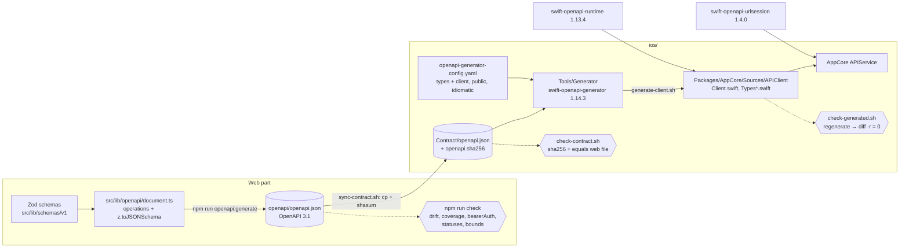

# Generated API client

The iOS app never hand-writes request or response types. They are generated from the web application's OpenAPI contract, which is generated from its Zod schemas. One source of truth, three drift checks.

## OpenAPI → Swift client generation



## The pieces

| Piece | Location | Notes |
|---|---|---|
| Contract copy | `ios/Contract/openapi.json` | identical to the web project's `openapi/openapi.json` (the published web 0.7.0 contract at generation) |
| Checksum | `ios/Contract/openapi.sha256` | also recorded in `native-ios-template/tools/web_contract.json` with the web release |
| Generator config | `ios/Contract/openapi-generator-config.yaml` | `generate: [types, client]`, `accessModifier: public`, `namingStrategy: idiomatic` |
| Generator | `ios/Tools/Generator` | its own package; never built by the app; no build plugin |
| Output | `ios/Packages/AppCore/Sources/APIClient/` | committed; target `APIClient` depends only on `OpenAPIRuntime` |
| Transport | `OpenAPIURLSession` | built on the ephemeral session from `Networking.makeSession()` |
| Typed wrapper | `AppCore/APIService.swift` | the only consumer of the generated `Client` |

## URLSession transport

`Networking.makeSession()` returns an **ephemeral** session configured so a credential can never leak or be forwarded:

- `httpShouldSetCookies = false`, `httpCookieAcceptPolicy = .never`, no cookie storage: the native client authenticates with its bearer token only;
- `urlCache = nil`, `reloadIgnoringLocalAndRemoteCacheData`: no cached authenticated answers;
- request timeout 30 s, resource timeout 60 s, `waitsForConnectivity = false`;
- a `NoRedirects` delegate that refuses every redirect (the API never redirects; one is a misconfiguration or an attack);
- certificate validation is the system's: never disabled, nothing pinned (`check-static.sh` enforces it).

## How `APIService` uses the generated types

The production wiring (`APIService.live`):

```swift
let client = Client(
    serverURL: configuration.baseURL,
    configuration: .init(dateTranscoder: FlexibleISO8601DateTranscoder()),
    transport: URLSessionTransport(configuration: .init(session: session)),
    middlewares: [BearerAuthMiddleware(apiBaseURL: configuration.baseURL, tokenStore: tokenStore,
                                       onAuthenticationFailure: onAuthenticationFailure)]
)
```

Each call switches over the generated response enum. Documented outcomes map to typed results or `AppError` (verbatim from `APIService.swift`):

```swift
switch try await client.getItem(path: .init(id: id)) {
case .ok(let ok): return Item(try ok.body.json)
case .unauthorized: throw AppError.unauthenticated
case .notFound(let failure): throw try Self.problem(failure.body.applicationProblemJson)
case .internalServerError(let failure): throw try Self.problem(failure.body.applicationProblemJson)
case .undocumented(let status, _): throw AppError.unexpectedStatus(status)
}
```

A shared `call` wrapper translates what the generated client throws: a transport failure becomes `AppError.network`, a response that does not decode becomes `AppError.invalidResponse("the response did not match the API contract")`.

Because the contract allows unknown response fields and treats the problem `code` as an open string, a server that adds a field or code within v1 does not break a shipped app.

## When the web API changes

1. Web part: change the schema/route; `npm run openapi:generate`; `npm run check`.
2. `sh ios/scripts/sync-contract.sh` (copies, records the checksum, regenerates).
3. Fix what the compiler and `sh ios/scripts/test.sh` report.
4. Commit `Contract/` and `Sources/APIClient/` together with the web change.

CI in the native template, and `check-generated.sh` locally, fail when the committed client is not what the contract generates.

## Releasing a native template for a new web contract

From `native-ios-template/docs/maintaining.md`: copy the **published** web release's `openapi/openapi.json` into `template/ios/Contract/`, write its checksum to `openapi.sha256` and to `tools/web_contract.json` with the release, run `generate-client.sh`, fix the app, release; then widen `NATIVE_REQUIRES_WEB` in `devkit`.
