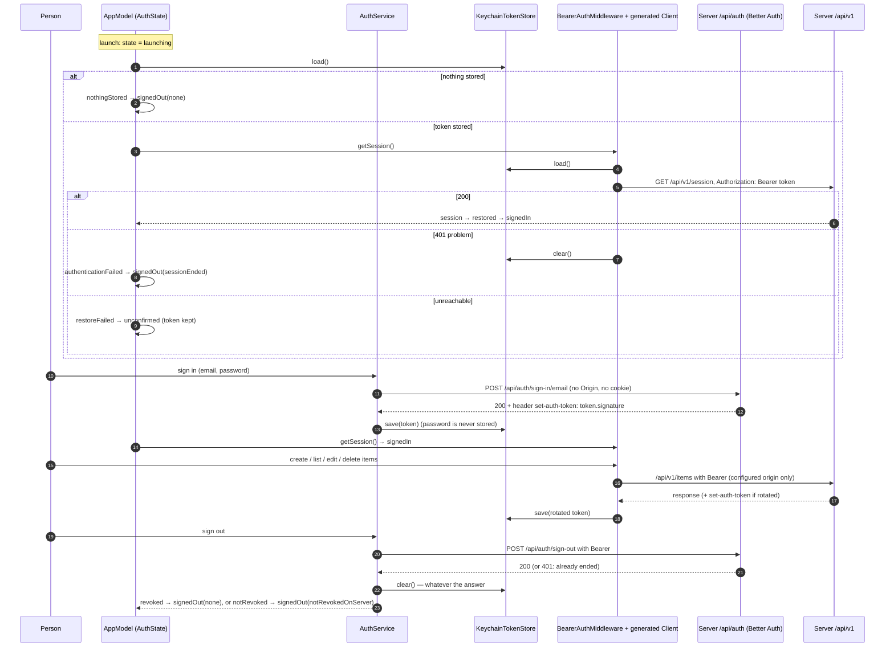

# Authentication and the Keychain

The iOS app uses the **same Better Auth session** as the browser, presented as a bearer token. The web side is described in [Native clients and the OpenAPI contract](../web/native-clients.md); this page is the client side.

## Native iOS authentication flow

## The Better Auth adapter (`AuthService`)

Token acquisition is Better Auth's documented API, **outside** the OpenAPI contract, so it lives in one small, separately tested place:

| Call | Request | Outcome |
|---|---|---|
| `signIn(email:password:)` | `POST /api/auth/sign-in/email` | 200 → `set-auth-token` saved; 401 → `invalidCredentials`; 429 → `rateLimited`; other 4xx → a problem built from Better Auth's `{code, message}` |
| `signUp(email:password:name:)` | `POST /api/auth/sign-up/email` | same; may be disabled by the deployment |
| `signOut()` | `POST /api/auth/sign-out` with the bearer token | 2xx or 401 → `.revoked`; anything else or a network failure → `.notRevoked(error)`; the Keychain entry is cleared **in every case** |

A token is stored only if it is *plausible*: 20–4096 printable ASCII characters (a signed token is `value.signature`). Requests send JSON, no `Origin`, no cookie.

## Bearer tokens and rotation (`BearerAuthMiddleware`)

For every generated-client request:

1. If the request's base URL has the **same scheme, host and port** as the configured API, add `Authorization: Bearer <token>`. Any other origin gets no token.
2. If the response carries `set-auth-token` with a plausible value, **replace** the stored token (rotation, for example after a password change that revoked other sessions).
3. If the request carried a token and the answer is **401 with `application/problem+json`**, clear the token and notify `AppModel` (through `AuthFailureRelay`), which moves to `signedOut(sessionEnded)`. Other errors do not sign the person out.

## Keychain storage (`KeychainTokenStore`)

| Attribute | Value | Consequence |
|---|---|---|
| `kSecClass` | `kSecClassGenericPassword` | |
| `kSecAttrService` | `<bundle id>.session` | scoped to this app; tests use unique services |
| `kSecAttrAccount` | `session-token` | |
| `kSecAttrAccessible` | `kSecAttrAccessibleWhenUnlockedThisDeviceOnly` | available only while unlocked; not restored to another device |
| `kSecAttrSynchronizable` | `false` | never in iCloud Keychain |

`save` updates in place (a rotated token replaces, not duplicates) or adds; `clear` treats "not found" as success. Errors surface as `AppError.storage(status)`. The token is never in `UserDefaults`, a file, a log, a URL, an error message or a view: `check-static.sh` greps for each of those, and a hosted test checks `UserDefaults` and the app's preference files.

## Session restoration

`AppModel.restore()` runs once at launch from `RootView` while the state is `launching`. The four outcomes map to four screens:

| State | Screen |
|---|---|
| `signedOut(.none)` | sign-in |
| `signedOut(.sessionEnded)` | sign-in, explaining the session ended elsewhere |
| `signedOut(.notRevokedOnServer)` | sign-in, explaining the server could not be told (the session stays valid until it expires) |
| `signedIn(session)` | items |
| `unconfirmed(error)` | "Can't reach the server": **Try again**, or **Sign out on this device** |

`unconfirmed` deliberately keeps the token: being offline is not a reason to forget a credential.

## The state machine

All transitions go through one pure function, `AuthState.reduced(by: AuthEvent)`, so it can be tested exhaustively:

| Event | New state |
|---|---|
| `restored(session)`, `signedIn(session)` | `signedIn(session)` |
| `nothingStored` | `signedOut(.none)` |
| `restoreFailed(error)` | `unconfirmed(error)` |
| `signedOut(.revoked)` | `signedOut(.none)` |
| `signedOut(.notRevoked)` | `signedOut(.notRevokedOnServer)` |
| `authenticationFailed` | `signedOut(.sessionEnded)` (unchanged if already signed out) |

The `ios/AGENTS.md` rule: authentication state changes **only** through `reduced(by:)`.
