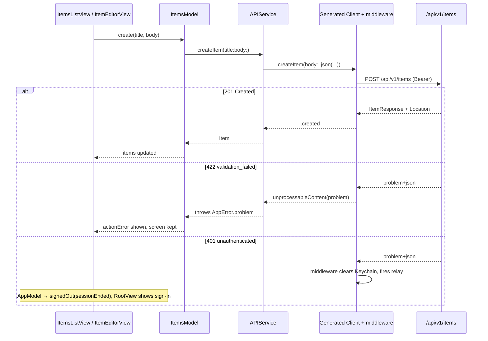

# Data flows

## CRUD through `ItemsModel`

`ItemsModel` (`@MainActor @Observable`) holds the signed-in person's items, a `phase` (`idle`, `loading`, `loaded`, `failed(AppError)`) and an `actionError` for failed actions.

| Action | API call (`APIService` → generated `Client`) | Success | Failure handling |
|---|---|---|---|
| `load()` | `GET /api/v1/items?limit=100&offset=0` | `items`, `phase = .loaded` (`isEmpty` drives the empty state) | `phase = .failed(error)` |
| `create(title:body:)` | `POST /api/v1/items` | 201 → item inserted | 422 (`validation_failed`, e.g. duplicate title) stays on screen as `actionError` |
| `update(_:title:body:)` | `PATCH /api/v1/items/{id}` | 200 → item replaced | 404 (not yours, or gone) → `actionError` |
| `delete(_:)` | `DELETE /api/v1/items/{id}` | 204 → removed | `actionError` |

Errors the server *explains* (validation, not found) keep the person where they are. A lost session is not `ItemsModel`'s business: the middleware's 401 handling moves `AppModel` to signed-out, and `RootView` switches screens.

## Sign-out and revocation

- **Sign out on this device** calls `AuthService.signOut()`: the server ends the session (`POST /api/auth/sign-out`), the Keychain entry is removed regardless, and the old token is dead everywhere. The end-to-end test proves the old token then gets `401`.
- If the server could not be reached, the token is still removed locally and the person is told the server-side session remains valid until it expires (`notRevokedOnServer`).
- Revocation from elsewhere (another device, `revoke-session`, a password change with `revokeOtherSessions`, expiry) surfaces on the next API call as a 401 problem → signed out with `sessionEnded`.

## Dates and problems

- `FlexibleISO8601DateTranscoder` decodes the API's ISO 8601 timestamps with or without fractional seconds.
- `ProblemDetails` mirrors RFC 9457 (`type`, `title`, `status`, `code`); the app branches on `code`, never on `title`. Unknown codes are kept as strings.

## Extending the app

1. Change the API in the web part, regenerate the contract, `sync-contract.sh` ([Generated API client](api-client.md)).
2. Add a method to `APIService` that switches over the new generated response cases.
3. Add state and actions to a model (`@MainActor @Observable`) in `AppCore`, with tests against the stand-in server in `Tests/AppCoreTests/Support.swift`.
4. Add views in `App/` (the synchronized folder picks them up).
5. `sh ios/scripts/test.sh`; for behaviour that crosses the network for real, extend `AppTests/EndToEndTests.swift` and run `node ios/scripts/e2e.mjs`.
