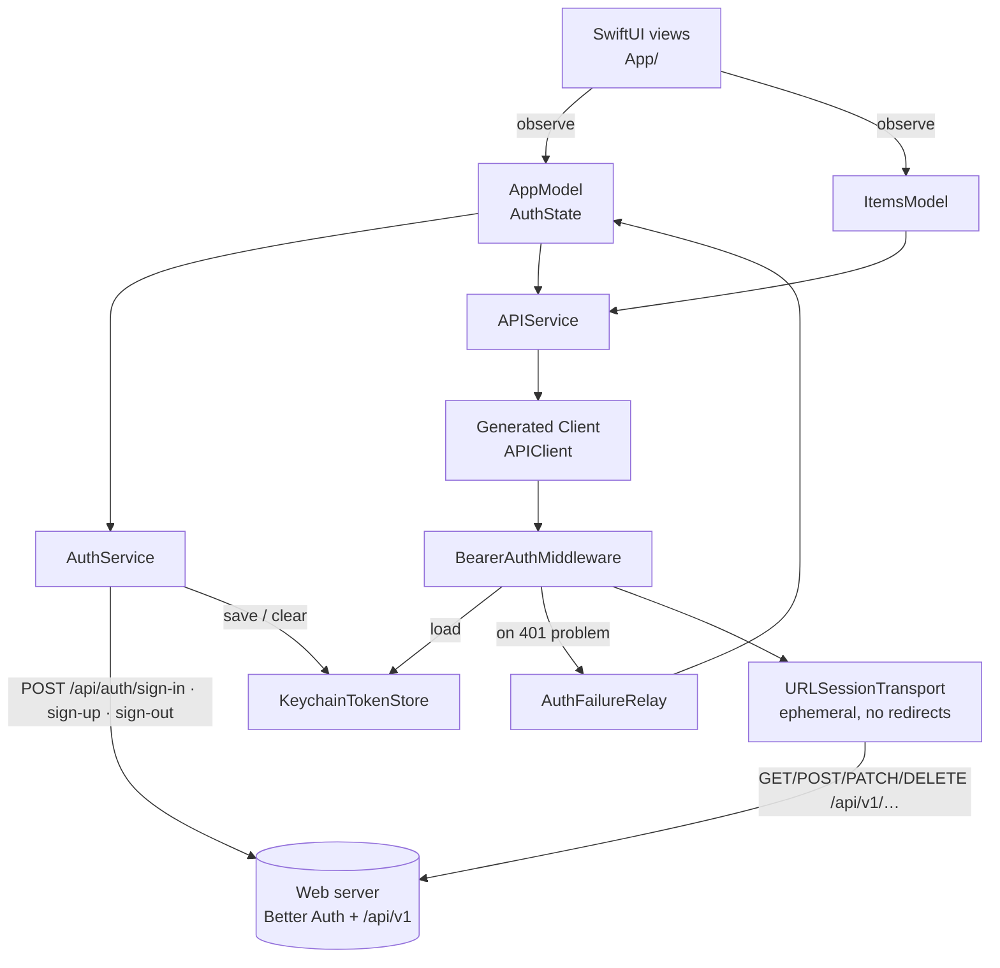

# Native iOS: app structure

The native layer (`native-ios-template` v0.1.1) adds a small SwiftUI app in `ios/` that uses the project's `/api/v1`: sign in or create a local account, see the session, list/create/edit/delete items, loading and empty states, problem-details errors, sign out. It is **an architecture to extend, not a design system**.

| | |
|---|---|
| Minimum iOS | 17.0 (`@Observable`, `NavigationStack`, `ContentUnavailableView`) |
| Language | Swift 6, complete strict concurrency, async/await, the Observation framework |
| API client | generated by Swift OpenAPI Generator 1.14.3 from `ios/Contract/openapi.json`, URLSession transport |
| Token storage | Keychain, `kSecAttrAccessibleWhenUnlockedThisDeviceOnly`, never synchronized |
| Signing | none for the simulator; no team, profile or certificate is committed |
| Third-party state libraries | none |

## Layout

```text
ios/
├── App.xcodeproj/                 # static, generated by tools/gen_pbxproj.py; settings are NOT here
├── App/                           # SwiftUI views only (synchronized folder)
│   ├── AppMain.swift              # @main: builds AppModel(environment: .live()) or shows a configuration problem
│   ├── RootView.swift             # switch on AuthState: launching / signedOut / signedIn / unconfirmed
│   ├── SignInView.swift           # sign in or create an account
│   ├── SignedInView.swift         # session, sign out
│   ├── ItemsListView.swift        # list, empty state, delete
│   └── ItemEditorView.swift       # create / edit
├── AppTests/                      # hosted in the app: Keychain, build configuration, end-to-end
├── Config/
│   ├── Shared.xcconfig            # display name, bundle id, iOS 17.0, Swift 6, strict concurrency
│   ├── Debug.xcconfig             # API_SCHEME=http, API_HOST=localhost:3000, Info-Debug.plist
│   ├── Release.xcconfig           # API_SCHEME=https, API_HOST=<release_api_host>, Info-Release.plist
│   ├── Info-Debug.plist           # NSAppTransportSecurity: NSAllowsLocalNetworking only
│   └── Info-Release.plist         # no NSAppTransportSecurity key at all
├── Contract/                      # openapi.json (web's), openapi.sha256, openapi-generator-config.yaml
├── Packages/AppCore/              # local Swift package: everything that is not UI
│   ├── Sources/APIClient/         # GENERATED: Client.swift, Types*.swift — never edit
│   ├── Sources/AppCore/           # see below
│   └── Tests/AppCoreTests/        # 58 tests with a stand-in server (no network)
├── Tools/Generator/               # pinned swift-openapi-generator package
├── scripts/                       # test, simulator, check-*, generate-client, sync-contract, e2e.mjs
└── AGENTS.md  CLAUDE.md  README.md
```

## AppCore

| Type | Role |
|---|---|
| `APIConfiguration` | Reads `APIScheme`/`APIHost` from `Info.plist`; Release accepts **only https**; Debug accepts http only for `localhost`, loopback and `*.local`; refuses credentials, paths, queries |
| `Networking.makeSession()` | ephemeral `URLSession`: no cookies, no cache, bounded timeouts, **no redirects followed**, system certificate validation |
| `TokenStore` / `KeychainTokenStore` / `InMemoryTokenStore` | the token's only home |
| `AuthService` | the Better Auth adapter: sign-in, sign-up, sign-out over `/api/auth/*` (outside the contract) |
| `BearerAuthMiddleware` | adds `Authorization: Bearer` for the configured origin only; adopts a rotated `set-auth-token`; on a confirmed 401 problem clears the token and signs out |
| `APIService` | typed wrapper over the generated `Client` for `/api/v1`: session, items CRUD; maps documented problems to `AppError` |
| `AuthState` + `AuthEvent` | the authentication state machine, one pure `reduced(by:)` function |
| `AppModel` (`@MainActor @Observable`) | owns `AuthState`; `restore()`, `signIn`, `signUp`, `signOut` |
| `ItemsModel` (`@MainActor @Observable`) | items, `Phase` (`idle`/`loading`/`loaded`/`failed`), `load`, `create`, `update`, `delete` |
| `AppError`, `ProblemDetails` | `problem`, `unauthenticated`, `invalidCredentials`, `rateLimited`, `network`, `invalidResponse`, `unexpectedStatus`, `storage` |
| `AppEnvironment` | wires configuration, Keychain, session and the two services once; `.live()` scopes the Keychain service to the bundle id |

## How the pieces fit



Pages: [Generated API client](api-client.md) · [Authentication and the Keychain](authentication.md) · [Data flows](data-flows.md) · [Testing and Release transport](testing.md).
