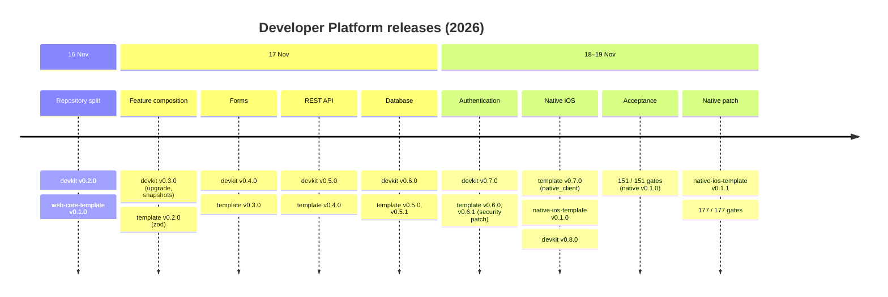

# Engineering history

How the baseline was reached, at an architectural level. Dates are tag dates (2026). The authoritative detail is each repository's `CHANGELOG.md`.

## Milestones

| # | Release(s) | Capability | Architectural change |
|---|---|---|---|
| 0 | devkit 0.1.0 (untagged in the split repo) | `doctor`, `new`, `--dry-run`; the Web Core template inside the platform | first cut, derived from the reference app `my-first-app` (shadcn/ui baseline `f244594`) |
| 1 | devkit **v0.2.0** (`11caaef`), template **v0.1.0** (`057d608`) | the template moves to its own repository with its own versions; published mode builds from a release tag and records the URL; `--template PATH` for development | **two repositories, one-way contract** (`profiles.py`); answer validation moves into `copier.yml`; CI on Linux for Python 3.12 and 3.14; private-repository access through credential helpers |
| 2 | devkit **v0.3.0** (`c4a9917`), template **v0.2.0** (`f78f009`) | optional `zod`; `devkit upgrade` (clean tree, range, kept selections, conflicts → exit 3) | feature composition: one question per feature, `features.yml`, the **lockfile matrix**, **strict booleans** (after `zod=banana` was silently accepted), `Option.since`, **offline contract snapshots** + live release gate; destructive-command rules and `scratch.py` (after the `rm -rf /dev/null` incident) |
| 3 | devkit **v0.4.0** (`ad77355`), template **v0.3.0** (`b4a901d`) | `forms` (requires zod) | first real `requires` rule, enforced by a template validator; CI evidence artifacts; `.prettierignore` fix for numeric `_commit` |
| 4 | devkit **v0.5.0** (`8eeed49`), template **v0.4.0** (`8d11179`) | `rest_api`: `/api/v1`, RFC 9457, handler tests | the server boundary that the database, auth and iOS later build on; additive-only v1 pinned by a contract test |
| 5 | devkit **v0.6.0** (`dc21f30`), template **v0.5.0** (`4b4c250`), **v0.5.1** (`c86699d`) | `database` = postgres \| supabase; SQL migrations; server-only data layer | first **choice** feature and first **sticky** option; Supabase as a provider, not an architecture; a separate CI `database` job with Docker; 0.5.1 fixed `db:status` on Supabase |
| 6 | devkit **v0.7.0** (`95db1c2`), template **v0.6.0** (`62e3f87`), **v0.6.1** (`12d3332`) | `auth`: Better Auth, `app_runtime`, RLS, protected API | **Better Auth on PostgreSQL for both providers** (Supabase Auth rejected); three-layer deny-by-default authorization; `sticky_reason`; 0.6.1 bumped Better Auth 1.7.15 → 1.7.16 for 12 advisories (reviewed as not exploitable in this configuration) |
| 7 | template **v0.7.0** (`094e35b`), native-ios-template **v0.1.0** (`cd346a0`), devkit **v0.8.0** (`e185d6d`) | `native_client` (bearer, OpenAPI 3.1); the SwiftUI app; `full-stack` and `native-ios` profiles; `devkit status`, `native add`, `upgrade --layer` | **template layering** in one directory (prototyped and adopted); `NATIVE_REQUIRES_WEB` pair rule; **staged, atomic two-layer generation** with `.devkit-partial`; generated Swift client with zero-diff regeneration in CI; hosted Keychain tests; local native e2e gate |
| 8 | – | **published-pair acceptance: 151 / 151** (native v0.1.0, the original accepted baseline) | fail-closed audit; preflight against stale Docker volumes |
| 9 | native-ios-template **v0.1.1** (`f0f4a5a`) | corrective patch: the generated `ios/README.md` documents `devkit upgrade PROJECT --layer native` (v0.1.0 named a non-existent subcommand); `check-release-config.sh` keeps its log in the ignored `ios/.derived-data/` (v0.1.0 left an un-ignored `ios/.derived-data-release.log` that made the next upgrade refuse) | no architecture, contract, client, dependency or behaviour change; devkit v0.8.0 unchanged (native range `>=0.1.0,<0.2.0`); regression tests for documented devkit commands and for a clean tree after the Release check; **published acceptance 177 / 177**, including a real v0.1.0 → v0.1.1 layer upgrade |

## Decisions that shaped the platform

| Decision | Alternatives rejected | Record |
|---|---|---|
| Copier for templates | create-next-app + scripts, Cookiecutter, GitHub template repos, Yeoman/Plop, Nx/Turborepo | `developer-platform/docs/architecture.md` |
| Separate repositories per template | one repository for CLI and template | same |
| Rules only in the template; devkit declares options | mirroring rules in devkit | `docs/feature-composition.md` |
| Committed lockfile per dependency set | `npm install` at generation; merging lock fragments; one lock with everything; npm workspaces | same |
| Strict booleans (`yaml` + choices + validator) | `type: bool`; string choices | same |
| Offline snapshots + local live gate | CI token to read the private template | `docs/release-strategy.md` |
| Better Auth on PostgreSQL for both providers | Supabase Auth for the Supabase provider | `docs/architecture.md` |
| Native iOS as an add-on template | a feature flag in the web template | `docs/feature-composition.md`, `docs/native-ios.md` |
| mise not adopted | mise for Node and Python | `docs/architecture.md` |

## Engineering practices that emerged

- **Template first, platform second, acceptance last**, every time.
- **Byte identity** with the previous release whenever a feature is off.
- **Fix forward**: a security patch (web 0.6.1), a bug fix (web 0.5.1) and a corrective patch (native 0.1.1) shipped as patch releases; no tag was ever moved.
- **Incidents become rules and tests**: the delete incident, the boolean cast, the numeric commit hash, the Supabase CLI's untracked folders, stale Docker volumes, and (native 0.1.1) a documented command that did not exist and a validation script that dirtied the tree.
