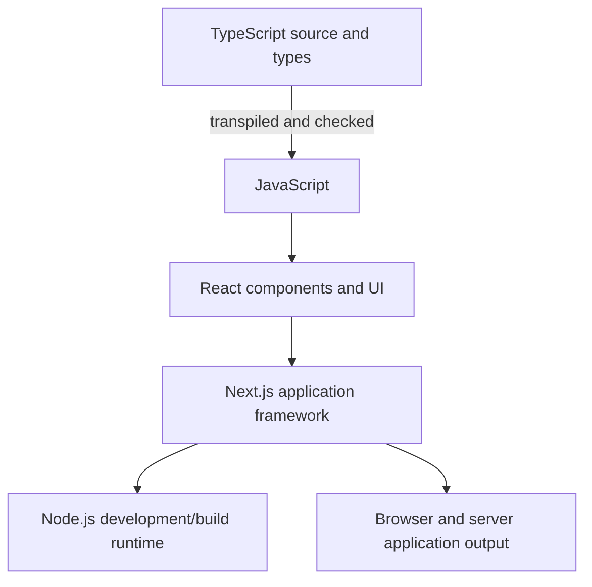

# Next.js, React, and TypeScript

The three technologies sit at different layers:

- **TypeScript** adds static type syntax to JavaScript; it is generally transformed into JavaScript for execution.
- **React** is a UI library for composing interfaces from components and managing rendered UI state.
- **Next.js** is a React framework that provides an application structure and integrates routing, rendering, development, and production build conventions.

This framing avoids treating the tools as substitutes. React can be used without Next.js; Next.js organizes a React application; TypeScript can type application code but does not replace runtime validation of untrusted data.

In this platform context, Next.js, React, and TypeScript are named as the Web Core stack. The exact router, rendering mode, and conventions require inspection of the released template. Learn more from the [TypeScript Handbook](https://www.typescriptlang.org/docs/), [React documentation](https://react.dev/learn), and [Next.js documentation](https://nextjs.org/docs).
