# Testing hierarchy

Tests exist at four levels, from a single function to the published releases working together. Each level catches failures the one below cannot.

| Level | What is tested | Examples | Where it runs |
|---|---|---|---|
| **1. Unit** | functions and modules in isolation | `devkit` option parsing; Zod schemas; the auth state machine; the bearer middleware | everywhere, always |
| **2. Generated-project** | a rendered app as a whole | `npm run check` (lint, types, format, 3–257 tests, build); `swift test`; `test.sh` | generated CI, template CI, locally |
| **3. Integration with real services** | real PostgreSQL, real Supabase, real Better Auth, real simulator | `npm run test:db`; the template's `db` suite; hosted Keychain tests; `e2e.mjs` | partly CI, partly local only |
| **4. Release and acceptance** | the platform and templates against each other and as published | live contract gate; byte-identity; lock refresh; published-pair acceptance (151 gates) | local, before and after tagging |

## Local validation → CI → release → published acceptance

```mermaid
flowchart LR
  subgraph L [Local, on a branch]
    l1[uv run pytest<br/>fast + e2e + db]
    l2[npm run check<br/>npm run test:db]
    l3[ios/scripts/test.sh<br/>check-* scripts]
  end
  subgraph C [GitHub CI, PR and main]
    c1[developer-platform<br/>pytest · py3.12 + 3.14]
    c2[web-core-template<br/>pytest not db · py3.12 + 3.14<br/>+ database job]
    c3[native-ios-template<br/>template job + macOS xcode job]
  end
  subgraph R [Release gates, local, before tagging]
    r1[pytest -m integration<br/>live contract vs templates]
    r2[compare_release.py<br/>refresh_locks.py --check]
    r3[e2e.mjs, both providers]
    r4[capture_contract.py --check<br/>from the new tag]
  end
  subgraph T [Tag]
    t1[annotated tag on the<br/>CI-verified merge commit]
  end
  subgraph A [Published-pair acceptance]
    a1[fresh clone at tags<br/>generate from GitHub<br/>every profile × provider]
    a2[151 fail-closed gates<br/>151 passed]
  end
  L --> C --> R --> T --> A
  A -. a failure means fix forward,<br/>new patch release .-> L
```

The order across repositories is fixed: **web template → native template → platform → acceptance**. A tag only ever points at a commit whose CI passed.

## Test inventory at the baseline

| Repository / project | Suite | Count |
|---|---|---|
| developer-platform | `uv run pytest` | 503 collected (28 `integration`) |
| web-core-template | `uv run pytest` | 919 collected (32 `e2e`, 109 `db`) |
| native-ios-template | `uv run pytest` | 43 collected (5 `xcode`) |
| generated basic web project | `npm run check` (Vitest) | 3 |
| generated full-stack project | `npm run check` / `npm run test:db` | 248 / 70 |
| generated native-ios project (web part) | `npm run check` / `npm run test:db` | 257 / 70 |
| generated native-ios project (iOS) | `swift test` / simulator package / hosted app | 58 / 58 / 11 |

Counts for the generated projects are from the published acceptance run; repository counts are `pytest --collect-only` at the release tags.

## Pages

- [Web and generated-project tests](web.md): unit, generated-project, PostgreSQL, Supabase, auth/authorization, OpenAPI drift.
- [Native tests](native.md): host, simulator package, hosted Keychain, native e2e.
- [GitHub CI versus local](ci.md): what runs where and why.
- [Release gates and acceptance](release-gates.md): the live gate, byte identity, and the 151-gate acceptance.
