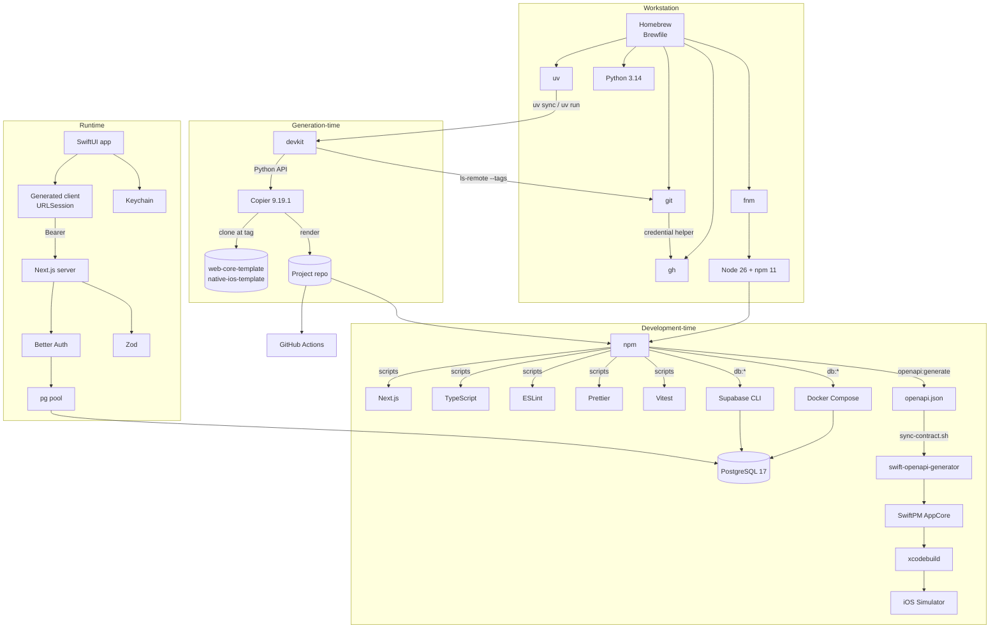

# How the tools fit together

Every significant tool on the platform, the phase it belongs to, and what calls it. The pages in this section describe each tool with the same fields: **problem solved, why selected, invoked by, consumes, produces, depended on by, phase, caveats**.

## Phases

| Phase | Meaning | Tools |
|---|---|---|
| **Workstation** | installed once by you | Homebrew, Git, gh, uv, Python, fnm, Node/npm, Docker, Xcode, Claude Code |
| **Generation** | runs when a project is created or upgraded | devkit, Copier, Jinja (inside Copier), Git (`ls-remote`) |
| **Development** | runs while you work | npm, Next.js, TypeScript, ESLint, Prettier, Vitest, Tailwind, shadcn CLI, Docker Compose, Supabase CLI, Xcode, SwiftPM, Swift OpenAPI Generator |
| **Runtime** | inside the running application | Next.js/React, Zod, React Hook Form, `pg`, PostgreSQL, Better Auth, SwiftUI, OpenAPIRuntime, URLSession transport, Keychain |
| **CI** | GitHub Actions | uv, pytest, npm, Node, Docker service containers, Xcode on macOS runners |
| **Release** | before and at tagging | pytest live gates, `capture_contract.py`, `compare_release.py`, `refresh_locks.py`, `e2e.mjs`, acceptance audit, `git tag`, `gh` |

## Interoperation

## Dependency cheat-sheet

| If this breaks… | …these stop working |
|---|---|
| uv / Python | `devkit`, Copier, all template and platform tests, this wiki's build |
| Git credentials | `devkit new`, `upgrade`, `status`, `native add`, raw Copier against a private template repository |
| Node 26 on `PATH` | `npm ci`, `npm run check`, `e2e.mjs`, the template's `e2e` tests |
| Docker daemon | `db:up`, `test:db`, the template's `db` tests, `e2e.mjs` |
| Xcode / simulator runtime | `ios/scripts/test.sh`, `check-release-config.sh`, the native template's `xcode` tests, `e2e.mjs` |
| `openapi/openapi.json` | `npm run check` (drift test), `check-contract.sh`, the Swift client |
| Better Auth config (`BETTER_AUTH_SECRET`) | every authenticated route, `test:db` auth suites |
