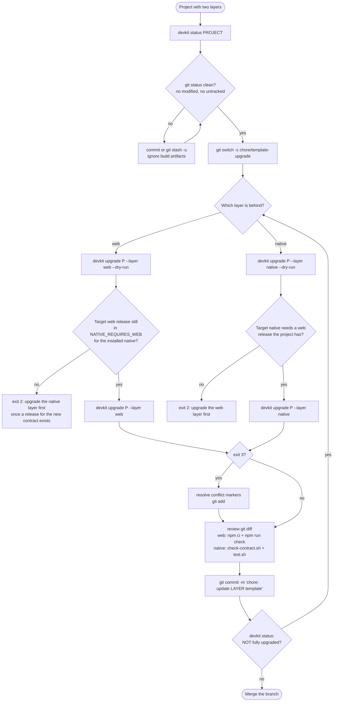

# Upgrade and Recovery

## Philosophy

1. **Git is the rollback.** Every upgrade starts from a clean, committed tree, so your work is always recoverable and never mixed with template changes. `devkit` never commits, so you review before anything is recorded.
2. **Never discard, never delete.** Upgrades merge; conflicts are left inline with both sides kept; `cleanup_on_error` is off for updates; a failed two-layer generation leaves its partial result for you to inspect.
3. **Never guess.** No architecture is chosen for you, no prerequisite is switched on, no layer is picked in a two-layer project, no unsupported release is used.
4. **One step, one review, one commit.** One target release per upgrade; one layer per upgrade; each committed on its own.
5. **Fix forward.** Published tags never move. A bad release is followed by a patch release, not a re-tag.

## The layered upgrade workflow

## Pages

| Page | Covers |
|---|---|
| [Upgrading the web layer](web.md) | `devkit upgrade`, enabling features, sticky options, Copier merges, preserving edits |
| [Two-layer projects](layers.md) | `--layer`, `devkit status`, `native add`, pair compatibility, raw Copier hazards |
| [Recovery procedures](recovery.md) | clean-tree requirements, `.devkit-partial`, interrupted operations, conflicts, rollback |
