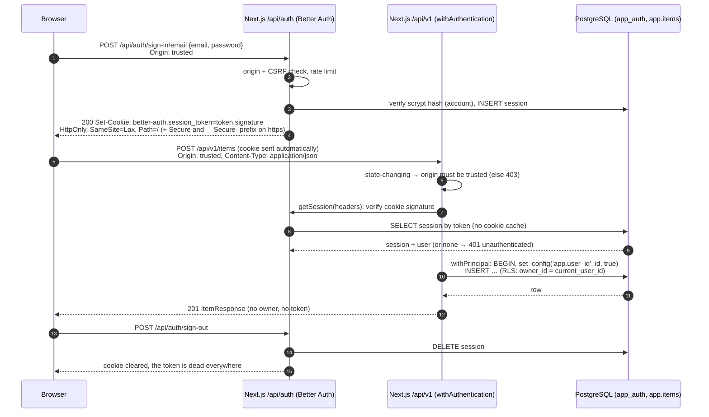

# Authentication and sessions

`auth` (template 0.6.0+, requires `zod`, `rest_api` and a database) adds email/password authentication with **Better Auth 1.7.16 on PostgreSQL, for both providers**. Supabase Auth is not used and stays disabled.

## Why Better Auth on PostgreSQL

From `developer-platform/docs/architecture.md`, "Decision: Better Auth on PostgreSQL for both database providers":

- **One architecture, not two.** The data layer is already provider-independent; Better Auth runs on `pg` directly, so authentication can be too. Supporting Supabase Auth beside it would mean two session mechanisms, two authorization models and code that must know its provider.
- **Authorization is PostgreSQL's**, through RLS and a runtime role, so the same migrations and tests run on both providers with identical outcomes.
- **The schema stays in the one migration history**; nothing alters it at run time.

## Server configuration (`src/server/auth/auth.ts`)

| Setting | Value | Effect |
|---|---|---|
| `database` | the shared `pg` pool | sessions, accounts and rate limits in PostgreSQL |
| `emailAndPassword` | enabled; 12–128 characters; `disableSignUp` unless allowed; `requireEmailVerification: false`; `revokeSessionsOnPasswordReset: true` | no mail service exists |
| `session` | `expiresIn` 7 days, `updateAge` 1 day, **`cookieCache` disabled** | every request reads the session row: sign-out, revocation, expiry, password change take effect immediately |
| `rateLimit` | enabled, `storage: "database"`, 60/min default (sign-in, sign-up, change-password 3 per 10 s) | holds across server instances |
| `advanced` | `defaultCookieAttributes: { httpOnly: true, sameSite: "lax" }`, `useSecureCookies` when `BETTER_AUTH_URL` is https, CSRF and origin checks **on**, no trusted client-address header unless configured | |
| `trustedOrigins` | `BETTER_AUTH_URL` + `AUTH_TRUSTED_ORIGINS` only; no wildcards; https in production | |
| `telemetry` | disabled | |
| `plugins` | `bearer({ requireSignature: true })` **only with `native_client`** | see [Native clients](native-clients.md) |

The instance is created on first use, never at import time, so a build needs no secrets.

## Browser authentication flow

## Cookie versus bearer authentication

The same Better Auth session can be presented two ways. They are **not** two systems.

| | Browser (cookie) | Native client (bearer) |
|---|---|---|
| Present in | every project with `auth` | only with `native_client=true` |
| Obtained from | `Set-Cookie` on sign-in/sign-up | the `set-auth-token` response header on sign-in/sign-up |
| Sent as | `Cookie: better-auth.session_token=…` (automatic) | `Authorization: Bearer <token.signature>` (explicit) |
| Value | the signed session token | the **same** signed value; unsigned or forged → 401 |
| Stored in | the browser cookie jar, `HttpOnly` | the iOS Keychain, device-only, unlocked-only |
| `Origin` header | sent by the browser; must be trusted for state changes | **none**; a request that names an untrusted origin is refused with or without a token |
| CSRF exposure | mitigated by origin checks, `SameSite=Lax`, JSON-only bodies, no CORS | not applicable (not ambient) |
| Expiry, revocation, sign-out | session row | the same session row |
| Rotation | cookie re-set by the server | adopt any new `set-auth-token` (a password change that revokes other sessions rotates the current one) |
| Session table | `app_auth.session` | `app_auth.session` |

How the bearer path works: the plugin converts `Authorization: Bearer <signed token>` into the session cookie **before** the session is read, so every downstream check (session lookup, expiry, `withAuthentication`, `withPrincipal`, RLS) is identical.

## Session lifecycle

- 7 days, refreshed at most once a day while used.
- Ends immediately on sign-out, `revoke-session`, expiry, or `change-password` with `revokeOtherSessions`.
- `/api/v1/sessions` lists your sessions without tokens; `/api/auth/list-sessions` (Better Auth's) is where tokens appear.

!!! warning "Better Auth's own responses include the session token"
    Sign-up, sign-in, `get-session` and `list-sessions` return the token in their bodies as part of Better Auth's API, so `HttpOnly` does not stop a script running **on your origin** from obtaining it. `/api/v1` never returns a token. Treat XSS seriously (a content security policy, no untrusted HTML) and keep sessions short.

## Not ready for the public internet

Ready for local development and integration testing. Before public exposure, the deployer must provide: email verification and password-reset delivery (no mail service is configured; keep `AUTH_ALLOW_SIGN_UP` off in production, the default), a sign-up and abuse policy, trusted-proxy configuration (`AUTH_TRUSTED_IP_HEADER`, `AUTH_TRUSTED_PROXIES`), `https` origins and TLS termination, secrets in a secret store, a managed PostgreSQL with the same two roles, monitoring and account recovery. The generated `docs/auth.md` lists them.

## Removing authentication

Not automated, and refused by `devkit upgrade` (sticky). By hand: back up; decide the fate of `app_auth` tables and each item's `owner_id`; add a migration for it (never edit the committed ones); remove `src/server/auth`, `src/lib/auth-client.ts`, the auth and protected routes and `better-auth`; give the application its own connection and authorization model before any data is reachable again.
