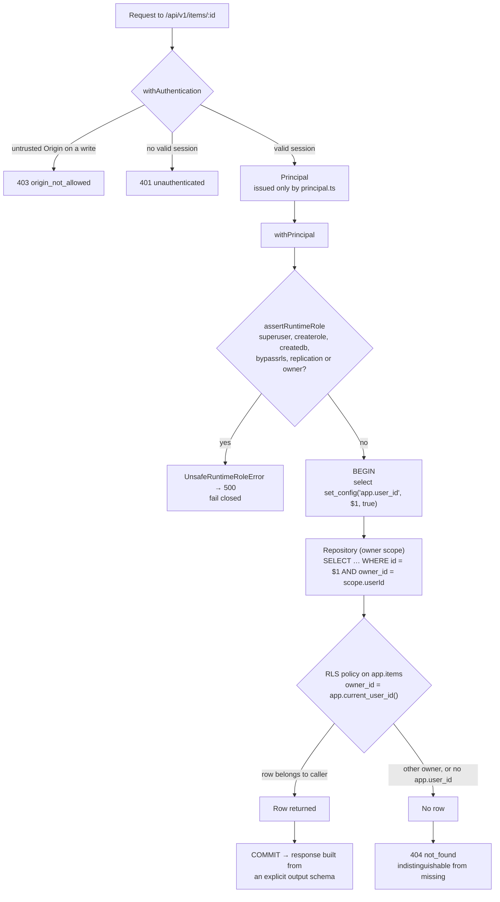

# Authorization and row-level security

Deny by default, in **three independent layers**: the route, the repository, and PostgreSQL itself. Any one of them failing does not expose another user's data.

## The database authorization flow



## Layer 1: the route

`withAuthentication(handler)` (`src/server/auth/guard.ts`):

- For non-safe methods, an `Origin` header must be absent or trusted; otherwise `403 origin_not_allowed`. Browsers always send `Origin` on cross-site POSTs; native clients send none.
- No valid session → `401 unauthenticated`, decided before the handler runs and before the database is touched.
- Otherwise the handler receives a `Principal`. Anything it throws becomes the generic 500 (`guarded`).

A `Principal` can only be issued by `src/server/auth/principal.ts` after a valid session; a caller cannot invent one from a user id.

## Layer 2: the repository

Every items repository function takes an **owner scope** (from `withPrincipal`), gets the owner from it, and filters on it. A user id from the request is never used. Route handlers never import the pool or `withTransaction` directly (a test enforces it).

## Layer 3: PostgreSQL

### The runtime role `app_runtime`

Created by `20260301000000_create_auth.sql`:

```sql
create role app_runtime nologin noinherit nosuperuser nocreatedb nocreaterole
  noreplication nobypassrls connection limit 20;
grant app_runtime to current_user with set true;   -- the owner may `set role app_runtime` (tests, debugging)
```

- No login and no password in the committed file. `npm run db:init` generates a random password into `.env.local` (`DATABASE_RUNTIME_URL`); `npm run db:migrate` / `db:roles` applies it.
- Owns nothing; cannot bypass RLS; usage on schema `app` only for application data; Better Auth's five tables in `app_auth` (a schema no HTTP API exposes).
- **Column-level grants** on `app.items`: `select, delete`; `insert (owner_id, title, body)`; `update (title, body, updated_at)`. It can never choose an id or timestamp, or move an item to another owner.
- The application checks itself on first database use (`runtime-role.ts`) and **refuses to continue** if its role is privileged, so pointing `DATABASE_RUNTIME_URL` at the owner fails closed instead of silently disabling the protections.

### Row-level security

From `20260301000100_scope_items_to_owner.sql`:

```sql
create function app.current_user_id() returns text language sql stable parallel safe
  as $$ select nullif(current_setting('app.user_id', true), '') $$;

alter table app.items add column owner_id text references app_auth."user" ("id") on delete cascade;
create unique index items_owner_title_key on app.items (owner_id, lower(title));

create policy items_select_own on app.items for select to app_runtime using (owner_id = app.current_user_id());
create policy items_insert_own on app.items for insert to app_runtime with check (owner_id = app.current_user_id());
create policy items_update_own on app.items for update to app_runtime
  using (owner_id = app.current_user_id()) with check (owner_id = app.current_user_id());
create policy items_delete_own on app.items for delete to app_runtime using (owner_id = app.current_user_id());
```

- `set_config('app.user_id', $1, true)` is **transaction-local**, so a pooled connection can never carry one request's identity into the next (tested with a single pooled connection and many concurrent users).
- With no user set, `current_user_id()` is null, `owner_id = null` is never true, and the role sees and changes **nothing**.
- So a statement that forgot its `owner_id` filter, or a raw query, still answers for the caller only.

## Why 404, not 403

Another user's item is `404 not_found`, indistinguishable from one that does not exist, so ids cannot be probed. There are no roles or permissions in the template; add them when needed, and answer 403 only for a caller **known** to lack a capability.

## What the design trusts

The server code that calls `set_config`. A SQL injection in application code could set it too, which is why every statement is parameterized, `withPrincipal` is the only place that sets it, and routes cannot reach the pool.

## Adding a table that holds user data

1. New migration: the table with an `owner_id` referencing `app_auth."user"`, `enable row level security`, the four policies on `app.current_user_id()`, and only the grants `app_runtime` needs (column-level for insert/update).
2. Zod schemas in `src/lib/schemas/`, a repository beside `src/server/items/` that takes the owner scope, `import "server-only"`.
3. Routes wrapped in `withAuthentication`, data only through `withPrincipal`.
4. `*.db.test.ts` covering owner, other user, no user, and injection attempts.
