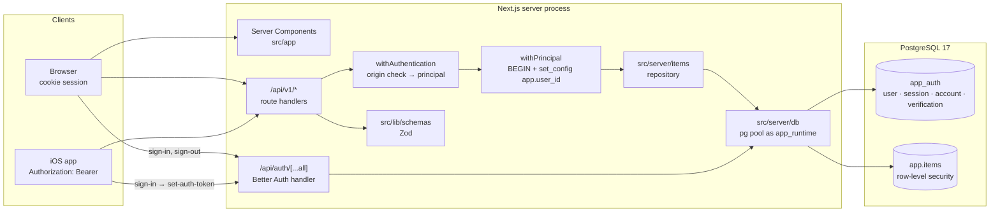

# Web Application

The generated web application at web-core-template `v0.7.0`, with every feature of the `native-ios` profile on: Next.js 16 App Router, TypeScript, Tailwind v4 + shadcn/ui, Zod, optional React Hook Form, a versioned REST API with RFC 9457 errors, PostgreSQL 17 (Docker Compose or the local Supabase stack), plain SQL migrations, a server-only data layer, Better Auth with database sessions, a least-privilege `app_runtime` role with row-level security, bearer tokens for native clients, and a deterministic OpenAPI 3.1 contract.

## Full-stack runtime architecture

## Layers and boundaries

| Layer | Location | Imported by | Rule |
|---|---|---|---|
| Pages and layouts | `src/app/` | – | Server Components by default |
| Shared schemas | `src/lib/schemas/` (`v1/` = API) | client and server | no secrets, no framework, environment or DB imports |
| Browser auth client | `src/lib/auth-client.ts` | client components | the only auth module the browser may import |
| Route handlers | `src/app/api/v1/`, `src/app/api/auth/` | Next.js | parse with `safeParse`; respond with `json()` / `problem()` |
| API helpers | `src/server/api/` | handlers | bounded body reading, problem documents |
| Auth | `src/server/auth/` | handlers | `withAuthentication`, `withPrincipal`, runtime-role check |
| Data access | `src/server/db/`, `src/server/items/` | `withPrincipal` scopes | parameterized SQL only; never imported by routes directly |

Every module under `src/server/` starts with `import "server-only"`; the production build refuses to bundle one into client code, and `src/server/boundary.test.ts` and `*/server-only.test.ts` fail if a client component can reach one.

## Request lifecycle (protected endpoint)

1. A request reaches `src/app/api/v1/items/route.ts`.
2. `withAuthentication` checks the **origin** for state-changing methods (403 `origin_not_allowed`), then asks Better Auth for the session from the cookie or bearer token (401 `unauthenticated` if none). It yields a `Principal`.
3. The handler reads the body (`application/json`, ≤ 8 KiB, UTF-8), `safeParse`s it with a Zod schema (422 `validation_failed`).
4. `withPrincipal(principal, …)` asserts the connection role is not privileged, opens a transaction, and runs `select set_config('app.user_id', $1, true)`.
5. The repository runs parameterized SQL; PostgreSQL's RLS policies restrict rows to `owner_id = app.current_user_id()`.
6. The handler validates the response against an explicit output schema and returns it; any unexpected error becomes a generic 500 problem.

## Pages in this section

| Page | Topic |
|---|---|
| [UI: Next.js, Tailwind, Zod, Forms](ui.md) | the front end, Cache Components, validation, forms |
| [REST API and problem details](rest-api.md) | `/api/v1`, RFC 9457, versioning |
| [PostgreSQL, Supabase and migrations](database.md) | providers, migrations, data layer |
| [Authentication and sessions](authentication.md) | Better Auth, cookies, browser flow, cookie vs bearer |
| [Authorization and row-level security](authorization.md) | `app_runtime`, `withPrincipal`, RLS |
| [Native clients and the OpenAPI contract](native-clients.md) | bearer plugin, deterministic contract |
