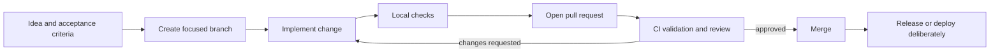

# Git branches and pull requests

Keep the default branch releasable and isolate a change on a short-lived topic branch. A pull request gives collaborators a reviewable diff and a place to discuss design and check results. CI provides repeatable evidence, but a green check cannot establish that a change meets the product need.

Before opening a PR, inspect `git status`, `git diff --check`, the staged diff, and test output. Link requirements, describe behavior, and note migration or security implications. Merge and release policies are repository-specific and pending source verification. See [Git and GitHub](../technology/git-github.md).
