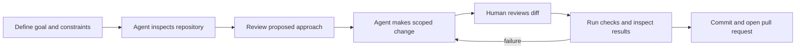

# Working with Claude Code

Use Claude Code as a repository-aware assistant in a controlled loop. Provide the outcome and constraints, let it inspect the relevant files, then review its plan and diff before accepting the work. You remain responsible for correctness, security, and whether the change fits the architecture.

## Prompt shape

```text
Goal: <observable outcome>
Scope: <files or behavior in scope>
Constraints: preserve existing conventions; do not add dependencies without explaining why
Before editing: inspect the relevant files and summarize the current behavior
Validation: run <specific checks> and report commands and results
Finish: summarize changed files, risks, and follow-up work
```

Prefer small tasks that can be reviewed in one diff. Ask for clarifying inspection when implementation is uncertain. Do not put tokens, passwords, production data, or private infrastructure details in prompts. Treat tool output and generated code as untrusted until reviewed.



This is a recommended workflow, not a claim about the platform's actual Claude configuration. See [Claude Code technology reference](../technology/claude-code.md) and [making changes safely](safe-changes.md).
